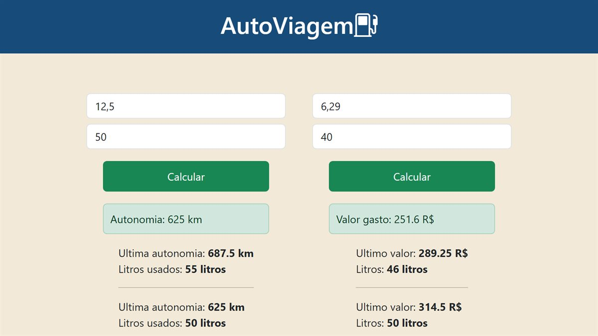

# AutoViagem

[](https://www.electronjs.org/)
[](https://developer.mozilla.org/docs/Web/JavaScript)

Aplicativo desktop em **Electron** para calcular a autonomia do veículo e o custo de abastecimento. A interface usa Bootstrap e mantém um histórico local das últimas simulações.



## Funcionalidades

- Cálculo de autonomia a partir do consumo (km/l) e da capacidade do tanque (l).
- Cálculo do valor gasto a partir do preço do combustível e da quantidade de litros.
- Histórico das simulações salvo no `localStorage` do aplicativo.
- Validação simples de campos vazios ou inválidos.
- Interface desktop leve, sem backend e sem login.

## Stack

| Camada | Tecnologia |
|---|---|
| Runtime desktop | Electron 39 |
| Interface | HTML, Bootstrap 5 e CSS |
| Lógica | JavaScript puro |
| Persistência | `localStorage` |

## Como rodar

Pré-requisitos: **Node.js 18+** e **npm**.

```bash
git clone https://github.com/Henriquewalker31/Auto-Viagem.git
cd Auto-Viagem
npm install
npm start
```

Se preferir rodar sem o script:

```bash
npx electron .
```

## Como usar

**Autonomia**

1. Informe o consumo médio do veículo em km/l.
2. Informe a capacidade do tanque em litros.
3. Clique em **Calcular** — o resultado aparece em km e entra no histórico.

**Custo do abastecimento**

1. Informe o valor do litro do combustível.
2. Informe a quantidade de litros.
3. Clique em **Calcular** — o valor total aparece em reais e entra no histórico.

Os históricos ficam salvos no armazenamento local do Electron e continuam disponíveis entre execuções.

## Estrutura do projeto

```
Auto-Viagem/
├── main.js                 # processo principal do Electron
├── renderer/
│   ├── index.html          # interface do aplicativo
│   ├── script.js           # cálculos e histórico
│   └── style.css
├── render/                 # versão antiga da interface (não utilizada)
├── package.json
└── package-lock.json
```

## Limitações e próximos passos

- Não há testes automatizados.
- O aplicativo não está empacotado para distribuição (`.exe`, `.dmg`, `.AppImage`); isso pode ser feito com `electron-builder`.
- O histórico não tem opção de limpar ou exportar.

## Autor

Feito por [Henrique Walker](https://github.com/Henriquewalker31). Veja o [portfólio](https://henriquewalker31.github.io/).
